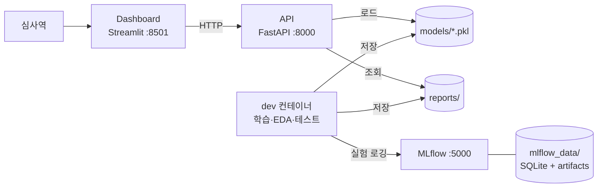

# XAI 기반 대안신용평가 시스템

> ⚠️ **본 시스템은 교육 목적으로 개발되었으며, 실제 금융 의사결정에 사용할 수 없습니다.**

## 프로젝트 개요

금융 이력이 부족한 씬파일러(Thin-filer)를 위해 통신비·공과금 납부 등 **대안 데이터**를 결합한 신용평가 모델을 만들고,
금융위원회 AI 가이드라인이 요구하는 **설명가능성(SHAP)** 과 **공정성(DI Ratio, Equalized Odds)** 을 검증하는 시스템이다.

- **데이터**: Kaggle Give Me Some Credit + 대안 데이터 시뮬레이터 (5개 변수)
- **모델**: Logistic Regression / XGBoost / LightGBM, 5-Fold Stratified CV, 불균형 처리 비교
- **XAI**: SHAP 전역·지역 해석, 거절 사유 Top 5 자연어 설명
- **공정성**: 성별·연령대별 DI Ratio, Equalized Odds, Bias Mitigation
- **통계 검증**: One-way ANOVA 2종 + Tukey HSD
- **서빙**: FastAPI(추론 API) + Streamlit(심사역 대시보드) + MLflow(실험 추적)

## 시스템 아키텍처



대시보드는 모델 파일을 직접 로드하지 않고 모든 추론·지표 조회를 API 로 요청한다 (MSA).
대시보드 이미지에는 ML 라이브러리 자체가 설치되지 않는다.

## 실행 방법

### 사전 준비

- [Docker Desktop](https://www.docker.com/products/docker-desktop/) (Docker Compose v2.22 이상 포함)

### 전체 서비스 실행

```bash
git clone <레포 URL>
cd <레포 디렉토리>
cp .env.example .env        # 선택: 없으면 기본값으로 실행
docker compose up --build   # docker-compose up 도 동일
```

| 서비스 | 주소 |
| --- | --- |
| API (Swagger UI) | http://localhost:8000/docs |
| 대시보드 | http://localhost:8501 |
| MLflow UI | http://localhost:5000 |

종료: `docker compose down`

### 개발 환경 (dev 컨테이너)

Python 3.10 과 전체 라이브러리가 설치된 컨테이너에 레포 전체가 `/app` 으로 마운트된다.
컨테이너 안에서 만든 파일(노트북, 모델, 리포트)은 호스트에 그대로 남는다.

```bash
# JupyterLab → http://localhost:8888 (토큰: .env 의 JUPYTER_TOKEN, 기본값 xai-dev)
docker compose --profile dev up -d dev

# 테스트
docker compose --profile dev run --rm dev pytest

# 모듈 실행 (항상 python -m src.xxx 형태로 실행)
docker compose --profile dev run --rm dev python -m src.models.train

# 컨테이너 셸
docker compose --profile dev run --rm dev bash
```

API·대시보드 코드를 수정하면서 바로 확인하려면 `docker compose watch` 를 실행한다 (`src/` 변경 시 자동 반영).

> **import 규칙**: 모든 모듈은 `from src.data.loader import ...` 처럼 `src.` 부터 import 하고,
> 스크립트는 `python -m src.models.train` 형태로 실행한다. (`src/statistics` 가 표준 라이브러리 `statistics` 와
> 이름이 같으므로 `src/` 를 sys.path 에 직접 넣으면 충돌한다.)

## 환경 변수

`.env.example` 을 `.env` 로 복사해 사용한다. 모델·비즈니스 임계값(분할 비율, DI Ratio 기준 등)은
[`configs/config.yaml`](configs/config.yaml) 에서 관리한다.

| 변수 | 기본값 | 설명 |
| --- | --- | --- |
| `API_PORT` / `DASHBOARD_PORT` / `MLFLOW_PORT` / `JUPYTER_PORT` | 8000 / 8501 / 5000 / 8888 | 호스트 측 포트 |
| `API_URL` | `http://localhost:8000` | 대시보드가 호출할 API 주소 (컨테이너에서는 `http://api:8000`) |
| `MLFLOW_TRACKING_URI` | `http://localhost:5000` | MLflow 서버 주소 (컨테이너에서는 `http://mlflow:5000`) |
| `MLFLOW_EXPERIMENT_NAME` | `xai-credit-scoring` | MLflow 실험 이름 |
| `MODEL_NAME` / `MODEL_VERSION` | `xgboost` / `v1.0` | API 가 로드할 모델 → `models/xgboost_v1.0.pkl` |
| `MODEL_DIR` / `DATA_DIR` / `REPORTS_DIR` | `models` / `data` / `reports` | 프로젝트 루트 기준 상대 경로 |
| `CONFIG_PATH` | `configs/config.yaml` | 모델·비즈니스 설정 파일 |
| `LOG_LEVEL` | `INFO` | 로그 레벨 |
| `PYTHON_VERSION` | `3.10` | Docker 이미지 Python 버전 |
| `KAGGLE_USERNAME` / `KAGGLE_KEY` | - | Kaggle 데이터 다운로드용 ([data/README.md](data/README.md)) |
| `JUPYTER_TOKEN` | `xai-dev` | JupyterLab 접속 토큰 |

## 디렉토리 구조

```
.
├── configs/
│   └── config.yaml          # 임계값·분할 비율·보호 속성 등 모델/비즈니스 설정
├── data/                    # 원본·전처리 데이터 (git 미추적, data/README.md 참고)
├── docs/                    # 실험 리포트 (experiment_report.pdf)
├── mlflow_data/             # MLflow 실험 DB·아티팩트 (docker 볼륨)
├── models/                  # 학습된 모델 ({name}_{version}.pkl)
├── notebooks/               # EDA·모델링·분석 노트북
├── reports/figures/         # SHAP·성능·공정성 그래프 등 분석 산출물
├── src/
│   ├── config.py            # 환경 변수(.env) + config.yaml 로더
│   ├── utils/               # 로거 등 공통 유틸
│   ├── data/                # loader, simulator, thin_filer, preprocessor
│   ├── models/              # train, evaluate, registry, scoring
│   ├── explainer/           # SHAP 해석, 거절 사유 생성
│   ├── fairness/            # DI Ratio, Equalized Odds, Bias Mitigation
│   ├── statistics/          # anova.py (One-way ANOVA, Tukey HSD)
│   ├── api/                 # FastAPI (main.py, schemas.py)
│   └── dashboard/           # Streamlit (app.py, api_client.py)
├── tests/                   # pytest 단위 테스트
├── Dockerfile               # 멀티 스테이지: mlflow / api / dashboard / dev
├── docker-compose.yml       # API + Dashboard + MLflow (+ dev 프로필)
├── requirements.txt         # 런타임 의존성 (버전 고정)
├── requirements-dev.txt     # 개발 도구 (pytest, jupyterlab, ruff)
├── requirements-dashboard.txt  # 대시보드 이미지 전용 (ML 라이브러리 제외)
├── pyproject.toml           # pytest·ruff 설정
└── .env.example             # 환경 변수 템플릿
```

## 팀 구성원 역할

| 이름 | 역할 | 담당 |
| --- | --- | --- |
| TBD | | |
| TBD | | |

## 협업 규칙

- **브랜치**: `main` 은 항상 실행 가능한 상태로 유지하고, 작업은 `feat/<주제>`, `fix/<주제>`, `docs/<주제>` 브랜치에서 한다.
- **이슈 → PR**: 작업마다 이슈를 만들고(`.github/ISSUE_TEMPLATE`), PR 본문에 `closes #이슈번호` 를 적어 연결한다.
- **커밋 메시지**: `feat:`, `fix:`, `docs:`, `test:`, `refactor:`, `chore:`, `build:` 접두어를 사용한다.
- **설정값**: 포트·경로·임계값은 `.env` 또는 `configs/config.yaml` 에 두고 코드에 하드코딩하지 않는다.

## 진행 현황

<details>
<summary>권장 구현 순서 체크리스트</summary>

- [x] 1. Docker 기반 개발 환경 구축 (Python 3.10, 필수 라이브러리)
- [x] 2. Git 레포지토리 생성 및 프로젝트 구조 설계
- [ ] 3. 공개 데이터셋 다운로드 및 EDA (Give Me Some Credit)
- [ ] 4. 대안 데이터 시뮬레이터 설계 및 구현
- [ ] 5. 씬파일러/씩파일러 레이블링 로직 구현
- [ ] 6. 전처리 파이프라인 개발 (결측치, 정규화, 인코딩)
- [ ] 7. Stratified Train/Valid/Test 분할
- [ ] 8. MLflow 설정 및 실험 추적 환경 구축
- [ ] 9. Logistic Regression 베이스라인 모델 학습 (MLflow 로깅)
- [ ] 10. XGBoost, LightGBM 모델 학습 및 하이퍼파라미터 튜닝
- [ ] 11. 불균형 처리 기법 비교 (class_weight, SMOTE)
- [ ] 12. 5-Fold Cross-Validation 및 성능 평가
- [ ] 13. AUC-ROC, KS 통계량 계산 모듈 개발
- [ ] 14. 씬파일러 집단 대안 데이터 효과 분석
- [ ] 15. ANOVA 통계 검증 모듈 개발 (2가지 검증 + Tukey HSD)
- [ ] 16. SHAP TreeExplainer 적용 및 전역 해석 시각화
- [ ] 17. SHAP 지역 해석 (Force Plot, Waterfall) 구현
- [ ] 18. 거절 사유 Top 5 자동 생성 로직 개발
- [ ] 19. 공정성 지표 계산 모듈 (DI Ratio, Equalized Odds)
- [ ] 20. Bias Mitigation 구현 (Reweighting, Threshold Adjustment)
- [ ] 21. FastAPI 서버 구현 (7개 엔드포인트)
- [ ] 22. Pydantic 스키마 정의 및 Swagger UI 설정
- [ ] 23. Streamlit 대시보드 구현 (5개 탭)
- [ ] 24. API ↔ 대시보드 연동 테스트
- [ ] 25. pytest 유닛 테스트 10개 이상 작성
- [ ] 26. docker-compose.yml 작성 및 통합 테스트 (API + Dashboard + MLflow)
- [ ] 27. 실험 리포트(PDF) 20페이지 이상 작성
- [ ] 28. README.md 완성, GitHub Issue/PR 정리, 최종 점검

</details>
