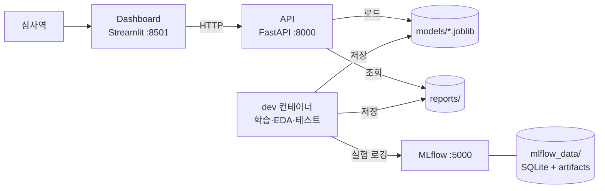

# XAI 기반 대안신용평가 시스템

> ⚠️ **본 시스템은 교육 목적으로 개발되었으며, 실제 금융 의사결정에 사용할 수 없습니다.**
> 대안 데이터 변수와 성별은 실제 값이 아닌 시뮬레이션 값입니다.

[English](README_EN.md)

## 프로젝트 개요

금융 이력이 부족한 씬파일러(Thin-filer)를 위해 통신비·공과금 납부 등 **대안 데이터**를 결합한 신용평가 모델을 만들고,
금융위원회 AI 가이드라인이 요구하는 **설명가능성(SHAP)** 과 **공정성(DI Ratio, Equalized Odds)** 을 검증하는 시스템이다.
4무원 팀의 캡스톤디자인II / 산학프로젝트(CSE4187, 서강대학교) 결과물이다.

- **데이터**: Kaggle Give Me Some Credit(GMSC) + 대안 데이터 시뮬레이터 (Gaussian copula, 과제 변수 5개 + 추가 변수 3개), 보조 데이터 German Credit
- **모델**: Logistic Regression / XGBoost / LightGBM × 피처 그룹(전통 / 대안 / 통합) × 불균형 처리(없음 / class_weight / SMOTE), 5 × 5겹 Stratified CV, 단조 제약
- **점수 체계**: 부도확률(PD) → 신용 점수(0~1000) → 리스크 등급(A~E) → 승인 (점수 475 이상)
- **XAI**: SHAP 전역·지역 해석, 거절 사유 Top 5 자연어 설명, 변수별 조치 가능성(DiCE 경로용)
- **공정성**: 성별·연령대별 DI Ratio, Equalized Odds, Bias Mitigation
- **통계 검증**: One-way ANOVA 2종 + Tukey HSD
- **서빙**: FastAPI(추론 API) + Streamlit(심사역 대시보드) + MLflow(실험 추적)

## 시스템 아키텍처



대시보드는 모델 파일을 직접 로드하지 않고 모든 추론·지표 조회를 API 로 요청한다 (MSA).
대시보드 이미지에는 ML 라이브러리 자체가 설치되지 않는다.

## 팀 구성원 역할

| 이름 | 역할 | 담당 |
| --- | --- | --- |
| 김원빈 | 데이터 · 모델링 | 데이터 로드·정제, 대안 데이터 시뮬레이터, 씬파일러 판정, 변수별 조치 가능성, 모델 비교·단조 제약 학습, PD → 점수 변환 |
| 체민규 | XAI · 공정성 · 통계 | SHAP 해석·거절 사유, DiCE 경로·비용 함수, 공정성 검증·Bias Mitigation, ANOVA |
| 윤제진 | MLOps · 서빙 | Docker 환경, MLflow 서버·Model Registry, FastAPI, Streamlit 대시보드 |
| TBD | | |

## 실행 방법

### 사전 준비

- [Docker Desktop](https://www.docker.com/products/docker-desktop/) (Docker Compose v2.22 이상 포함)
- 데이터: [data/README.md](data/README.md) 를 따라 `data/raw/cs-training.csv` (필수), `data/raw/german.data` (보조 모델용) 를 넣는다.
  학습된 모델 `models/xgboost_v1.0.joblib` 과 보고서 `reports/` 는 레포에 포함되어 있어, 데이터 없이도 서비스는 실행된다.

### 1. 전체 서비스 실행

```bash
git clone <레포 URL>
cd <레포 디렉토리>
cp .env.example .env        # 선택: 없으면 기본값으로 실행
docker compose up --build   # docker-compose up 도 동일
```

| 서비스 | 주소 |
| --- | --- |
| API (Swagger UI) | http://localhost:8000/docs |
| 대시보드 | http://localhost:8501 |
| MLflow UI | http://localhost:5000 |

종료: `docker compose down`

### 2. 데이터 파이프라인과 모델 학습 (dev 컨테이너)

순서대로 실행한다 (시드 고정). dev 컨테이너는 `MLFLOW_TRACKING_URI=http://mlflow:5000` 이므로
모든 실행이 MLflow UI 에 기록된다 (실험: `nextstep-lr`, `nextstep-lgbm`, `nextstep-xgb`, `nextstep-final`, `nextstep-audit`).

```bash
# 정제: data/raw/cs-training.csv → data/processed/gmsc_clean.csv (컬럼명·타입·결측 비율 출력)
docker compose --profile dev run --rm dev python -m src.data

# 대안 데이터 시뮬레이터: → data/processed/gmsc_sim.csv
docker compose --profile dev run --rm dev python -m src.data.simulator

# 모델 비교 → 단조 제약 → 최종 모델 (약 15분): models/xgboost_v1.0.joblib, reports/*.csv, final_summary.json
docker compose --profile dev run --rm dev python -m src.models.train --stage all
```

선택: 보고서·그림·점검, 조치 가능성 Excel, German Credit 보조 모델 (약 20초)

```bash
docker compose --profile dev run --rm dev python notebooks/eda.py
docker compose --profile dev run --rm dev python notebooks/simulator_report.py
docker compose --profile dev run --rm dev python notebooks/simulator_scenarios.py
docker compose --profile dev run --rm dev python notebooks/model_report.py
docker compose --profile dev run --rm dev python notebooks/audit.py
docker compose --profile dev run --rm dev python -m src.data.actionability_table
docker compose --profile dev run --rm dev python -m src.models.german
```

### 3. 개발 환경 (dev 컨테이너)

Python 3.12 와 전체 라이브러리가 설치된 컨테이너에 레포 전체가 `/app` 으로 마운트된다.
컨테이너 안에서 만든 파일(노트북, 모델, 리포트)은 호스트에 그대로 남는다.

```bash
# JupyterLab → http://localhost:8888 (토큰: .env 의 JUPYTER_TOKEN, 기본값 xai-dev)
docker compose --profile dev up -d dev

# 테스트
docker compose --profile dev run --rm dev pytest

# 컨테이너 셸
docker compose --profile dev run --rm dev bash
```

API·대시보드 코드를 수정하면서 바로 확인하려면 `docker compose watch` 를 실행한다 (`src/` 변경 시 자동 반영).

> **import 규칙**: 모든 모듈은 `from src.data.loader import ...` 처럼 `src.` 부터 import 하고,
> 스크립트는 `python -m src.models.train` 형태로 실행한다. (`src/statistics` 가 표준 라이브러리 `statistics` 와
> 이름이 같으므로 `src/` 를 sys.path 에 직접 넣으면 충돌한다.)

### Docker 없이 로컬에서 실행

Python 3.12 이상이 필요하다 (xgboost 3.4, 학습된 모델의 라이브러리 버전).

```bash
bash setup.sh                 # Windows: setup.bat
source .venv/bin/activate     # Windows: .venv\Scripts\activate
python -m src.data
python -m src.data.simulator
python -m src.models.train --stage all
```

`MLFLOW_TRACKING_URI` 를 셸에 설정하지 않으면 로컬 SQLite 저장소 `mlruns/` 에 기록된다.
보기: `mlflow ui --backend-store-uri sqlite:///mlruns/mlflow.db`.
로컬 `mlruns/` 를 컨테이너로 복사하지 않는다 (아티팩트 절대 경로가 저장되어 있음). Docker 에서는 학습을 다시 실행한다.

> **Windows 주의:** 배포 모델은 macOS 에서 학습되어, Windows 용 XGBoost 는 모델에 저장된 난수 상태(`rng_state`)
> 형식을 읽지 못한다 (`XGBoostError: input stream corrupted`). Linux 컨테이너(api·dev)에서는 정상으로 불러온다.
> Windows 에서는 학습과 테스트를 dev 컨테이너에서 하고, Windows 에서 직접 학습한 모델은 커밋하지 않는다.

### 테스트

```bash
pytest
```

일부 테스트는 커밋되지 않는 파일(`data/processed/*.csv`, `mlruns/`)이 필요하다. 위 파이프라인 명령으로 만든다.

- **기본값:** 해당 파일이 없으면 그 테스트는 실행할 명령을 알려주는 메시지와 함께 **건너뛴다(skip)**.
- **`REQUIRE_DATA=1`:** 파일이 없으면 해당 테스트가 건너뛰지 않고 **실패**한다. CI 와 최종 점검에서 설정한다.
  dev 컨테이너에는 `.env` 의 `REQUIRE_DATA` 가 전달된다.
- MLflow 기록 검사(`tests/test_versioning_mlflow.py`)는 로컬 저장소 `mlruns/` 를 읽는다.
  MLflow 서버에만 기록한 경우 이 테스트는 건너뛴다 (`REQUIRE_DATA=1` 이면 실패).
- Windows 에서 직접 실행하면 배포 모델을 불러오는 테스트 3개가 위 Windows 주의 때문에 실패한다. dev 컨테이너에서 실행한다.

## API 엔드포인트

Swagger UI: http://localhost:8000/docs (요청 예시 포함). 응답의 `is_dummy` 가 `true` 인 값은 아직 계산할 수 없어
넣은 예시 값이며, 대시보드에는 🟡 **더미 데이터** 로 표시된다 (`src/api/dummy.py`).

| 엔드포인트 | 메서드 | 내용 | 데이터 |
| --- | --- | --- | --- |
| `/health` | GET | 상태, 모델 버전 | 실제 |
| `/predict` | POST | 신용 점수(0~1000), 승인 여부, 부도 확률, 리스크 등급(A~E), 씬파일러 여부 | 실제 (배포 모델) |
| `/explain` | POST | 거절 사유 Top 5 (feature, current_value, shap_contribution, explanation), 변수별 SHAP | 실제 (배포 모델 + SHAP) |
| `/fairness` | GET | 성별·연령대 DI Ratio, Equalized Odds (TPR/FPR 차이), 집단별 승인율 | 실제 (`reports/audit/2_fairness.json`) |
| `/fairness/mitigation` | GET | Mitigation 전/후 비교 | 전: 실제, **후: 더미** (`src/fairness` 구현 전) |
| `/metrics` | GET | AUC, KS, Precision, Recall, F1, 혼동행렬, 등급표 | 실제 (`reports/final_summary.json`), **ROC/PR 곡선 좌표: 더미** |
| `/anova` | GET | One-way ANOVA 2종 (F, p, η²), Tukey HSD | 실제 (`reports/cv_fold_auc.csv`) |
| `/explain/global` | GET | 전역 SHAP 중요도 (대시보드용) | 실제 (Top 10, `reports/shap_global_top10.csv`) |
| `/features` | GET | 입력 변수 설명·범위·기본값 (대시보드 입력 폼용) | 실제 |

- 고객 입력 JSON 의 키는 학습 데이터 컬럼명이다 (예: `NumberOfTimes90DaysLate`). 값이 `null` 이면 학습 데이터 중앙값으로
  대체되며, 원시 입력에는 학습 때와 같은 정제 규칙(특수코드 96/98, 소득 결측·0, 사용률 이상치)이 적용된다 (`src/models/predictor.py`).
- 거절 사유의 `shap_contribution` 은 과제 예시처럼 승인 방향 기준이다 (음수 = 거절 쪽). 비교 기준은 학습 데이터 중앙값이다.
- `/predict` 응답 시간은 약 0.03초다 (모델과 SHAP explainer 는 서버 시작 때 미리 불러온다).
- ANOVA 검증 정의(집단, 필터, 라벨)는 `configs/config.yaml` 의 `statistics.anova` 에서 바꿀 수 있다.

## 모델 결과 (공식: 테스트 세트, 배포 모델 `models/xgboost_v1.0.joblib`)

XGBoost, 변수 21개, 불균형 처리 없음, 단조 제약 13개. train + validation 으로 학습하고 15% 테스트 세트에서 한 번만 평가. 95% 부트스트랩 구간.

| 과제 목표 | 테스트 결과 |
| --- | --- |
| AUC ≥ 0.78 | 0.949 (0.944~0.953) |
| KS ≥ 0.28 | 0.760 (0.745~0.776) |
| 씬파일러 AUC 향상 ≥ +0.03 | +0.071 (+0.052~+0.092) |
| PSI < 0.1 | 0.0004 |
| 단조 제약으로 인한 AUC 손실 ≤ 0.01 | 0.0000 (validation) |

**이 수치는 낙관적이다.** 시뮬레이터가 테스트 세트를 포함한 모든 행에 실제 결과를 사용하며 (과제 예시와 같은 방식),
과제 변수 각각이 단독으로 AUC 0.80~0.84 에 도달한다. 현실적인 기준은 GMSC 만 사용한 모델이다
(CV AUC 0.864, 씬파일러 테스트 AUC 0.861). [reports/model_report_ko.md](reports/model_report_ko.md) 참고.

## 환경 변수

`.env.example` 을 `.env` 로 복사해 사용한다. 모델·비즈니스 설정값은 `configs/*.yaml` 에서 관리한다 (아래 설정 파일 참고).

| 변수 | 기본값 | 설명 |
| --- | --- | --- |
| `API_PORT` / `DASHBOARD_PORT` / `MLFLOW_PORT` / `JUPYTER_PORT` | 8000 / 8501 / 5000 / 8888 | 호스트 측 포트 |
| `API_URL` | `http://localhost:8000` | 대시보드가 호출할 API 주소 (컨테이너에서는 `http://api:8000`) |
| `MLFLOW_TRACKING_URI` | `http://localhost:5000` | MLflow 서버 주소 (컨테이너에서는 `http://mlflow:5000`). 학습 스크립트는 셸 환경 변수를 읽으며, 없거나 폴더 경로면 로컬 `mlruns/` |
| `MODEL_NAME` / `MODEL_VERSION` | `xgboost` / `v1.0` | API 가 로드할 모델 → `models/xgboost_v1.0.joblib` |
| `MODEL_DIR` / `DATA_DIR` / `REPORTS_DIR` | `models` / `data` / `reports` | 프로젝트 루트 기준 상대 경로 |
| `CONFIG_PATH` | `configs/config.yaml` | 공통 설정 파일 (과제 임계값, XAI·공정성·통계) |
| `LOG_LEVEL` | `INFO` | 로그 레벨 |
| `PYTHON_VERSION` | `3.12` | Docker 이미지 Python 버전 |
| `REQUIRE_DATA` | `0` | `1` 이면 데이터가 필요한 테스트가 건너뛰지 않고 실패 |
| `KAGGLE_USERNAME` / `KAGGLE_KEY` | - | Kaggle 데이터 다운로드용 ([data/README.md](data/README.md)) |
| `JUPYTER_TOKEN` | `xai-dev` | JupyterLab 접속 토큰 |

## 설정 파일 (모든 설정은 코드가 아니라 여기에 있음)

| 파일 | 내용 |
| --- | --- |
| `configs/config.yaml` | 과제 성능 목표, 면책 조항, XAI(Top 15, 거절 사유 5개), 공정성(보호 속성, DI 0.8~1.25, EO 0.10), 통계(α, η² 기준) |
| `configs/data.yaml` | 정제 규칙 (특수코드, 사용률 기준, 최소 연령) |
| `configs/simulator.yaml` | 대안 변수 8개 (분포, 관측·잠재 상관 목표, 공통 요인), 신용 연결, `thin_filer_ratio` / `thin_filer_mode` / `bias_ratio`, 씬파일러 규칙, 연령대 |
| `configs/actionability.yaml` | 변수별 조치 가능성 분류, 방향, 단위, 허용 범위, 단조 부호, `dice_vary`, `model_feature`, 비고 (한국어, 영어) |
| `configs/train.yaml` | 분할 (70/15/15), 교차검증 (5 × 5겹), 모델 비교 조합, 하이퍼파라미터, 선정 규칙, 모델 버전, MLflow 실험 |
| `configs/scoring.yaml` | PD → 점수(0~1000), 등급 A~E, 승인 규칙 (점수 475 이상), 경로 목표 (495) |
| `configs/german.yaml` | German Credit 보조 모델 |

## 디렉토리 구조

```
.
├── configs/                 # 설정 YAML (위 표)
├── data/                    # raw/ · processed/ (git 미추적, data/README.md 참고)
├── docs/                    # 실험 리포트 (experiment_report.pdf)
├── mlflow_data/             # MLflow 서버 DB·아티팩트 (docker 볼륨, git 미추적)
├── models/                  # 학습된 모델 ({algorithm}_v{version}.joblib, 예: xgboost_v1.0.joblib)
├── notebooks/               # EDA·시뮬레이터·모델·점검 보고서 스크립트 (src/ 는 이것에 의존하지 않음)
├── reports/                 # 보고서(한국어·영어), figures/, 결과표, 조치 가능성 Excel, 팀 인계 파일
├── src/
│   ├── config.py            # 환경 변수(.env) + configs/config.yaml 로더
│   ├── utils/               # 로거 등 공통 유틸
│   ├── data/                # loader, preprocessor, simulator, features(씬파일러 판정), actionability_table
│   ├── models/              # train, evaluate, scoring, german, predictor(서빙) (+ registry 예정)
│   ├── explainer/           # shap_explainer (TreeExplainer), reasons (거절 사유 문장)
│   ├── fairness/            # DI Ratio, Equalized Odds, Bias Mitigation
│   ├── statistics/          # anova.py (One-way ANOVA, η², Tukey HSD)
│   ├── api/                 # FastAPI (main.py, schemas.py, reports.py, dummy.py)
│   └── dashboard/           # Streamlit (app.py, api_client.py)
├── tests/                   # pytest 단위 테스트
├── Dockerfile               # 멀티 스테이지: mlflow / api / dashboard / dev
├── docker-compose.yml       # API + Dashboard + MLflow (+ dev 프로필)
├── requirements.txt         # 런타임 의존성 (버전 고정)
├── requirements-dev.txt     # 개발 도구 (pytest, jupyterlab, ruff)
├── requirements-dashboard.txt  # 대시보드 이미지 전용 (ML 라이브러리 제외)
├── pyproject.toml           # pytest·ruff 설정
├── setup.sh / setup.bat     # Docker 없이 로컬 가상환경 설정
└── .env.example             # 환경 변수 템플릿
```

`mlruns/` (로컬 MLflow 저장소) 는 git 에서 제외되며 `python -m src.models.train` 으로 다시 만든다.

## 보고서

| 주제 | 보고서 |
| --- | --- |
| 데이터 정제와 씬파일러 정의 | [reports/data_report_ko.md](reports/data_report_ko.md) |
| 탐색적 분석 | [reports/eda_report_ko.md](reports/eda_report_ko.md) |
| 대체 데이터 시뮬레이터 | [reports/simulator_report_ko.md](reports/simulator_report_ko.md) |
| 모델 비교, 테스트 결과, SHAP, 점수 체계 | [reports/model_report_ko.md](reports/model_report_ko.md) |
| 점검 (경로, 공정성, 안정성, 민감도) | [reports/audit_report_ko.md](reports/audit_report_ko.md) |
| MLflow 안내 | [reports/mlflow_schema_ko.md](reports/mlflow_schema_ko.md) |
| ANOVA 인계 | [reports/anova_handoff_ko.md](reports/anova_handoff_ko.md) |
| German Credit 보조 모델 | [reports/german_report_ko.md](reports/german_report_ko.md) |
| 조치 가능성 표 | `reports/actionability_table_ko.xlsx` (YAML 에서 생성, 직접 수정 금지) |

모든 보고서는 영어 버전(`_en`)도 있다. 최종 실험 리포트(PDF)는 `docs/experiment_report.pdf` 로 제출한다.

## 팀원 연계 (진행 중 과제)

**모두:** `data/processed/split.csv` (row_id, split) 가 train / validation / test 를 정한다. 기준점과 공정성 완화는 **validation** 에서 조정하고 **test** 에서 보고한다.

**체민규 (공정성, SHAP, DiCE, 비용 함수, ANOVA)**
- `configs/actionability.yaml` 과 Excel: DiCE 가 바꿀 수 있는 변수(`dice_vary`), 방향, 단위, 허용 범위, 난이도, 단계당 개월. `spending_consistency` 의 단위, 난이도, 기간은 멘토 검토가 필요한 팀 가정이다.
- 경로 목표: 점수 495 (`recourse_target_score`), 승인은 475 유지. 495 를 목표로 한 경로는 재학습해도 90.8% 가 승인을 유지한다.
- **거절 사유:** 권장 불가 변수 (SHAP 1위·2위인 `regular_payment_count`, `app_login_frequency` 와 대출·신용한도 수, 부동산 담보대출 수) 는 조언이 아니라 "참고(변경 불가)" 로만 표시한다. 시간 의존 경로는 기다리는 기간으로 표현한다.
- **공정성 미결 과제:** 연령대 균등 기회(EO) 격차가 0.121 로 목표 0.10 을 충족하지 못한다 (DI 0.832 와 성별은 통과).
- **경로 미결 과제:** 495 목표의 경로 커버리지가 12개월 87.9% (24개월 91.8%) 로 목표 90% 에 미달한다 (점검 보고서 참고).
- DiCE 에서 소득과 부채비율을 연결해야 한다 (소득이 오르면 부채비율이 내려감).
- ANOVA 데이터: `reports/cv_fold_auc.csv` (5 × 5 폴드, 세그먼트 all / thin / general) 와 [reports/anova_handoff_ko.md](reports/anova_handoff_ko.md).
- 실제 성별 점검: `reports/german/oof_predictions.csv` ([reports/german_report_ko.md](reports/german_report_ko.md) 참고).
- **API·대시보드 연결 지점:** 거절 사유 `src/explainer/reasons.py`, ANOVA `src/statistics/anova.py` 는 1차 구현이다 (자유롭게 수정). Bias Mitigation 을 구현하면 `src/api/dummy.py` 의 `mitigated()` 대신 그 결과를 `/fairness/mitigation` 에 연결한다.

**윤제진 (MLflow, Docker, FastAPI, Streamlit)**
- [reports/mlflow_schema_ko.md](reports/mlflow_schema_ko.md): 실험 (알고리즘별, final, audit), 지표 키, 입력 열 21개, 모델 불러오는 방법. 모든 모델 아티팩트에 signature 와 input example 이 있으며, 서빙 모델은 확률을 반환한다 (1번 열 = PD).
- 학습 코드는 MLflow 3 API 를 사용한다. Model Registry 등록 시 stage 는 MLflow 3 에서 deprecated 이므로 alias(예: `production`, `staging`) 또는 태그로 표시한다.
- MLflow 서버에 실험을 남기려면 dev 컨테이너에서 학습을 다시 실행한다 (위 실행 방법 2).
- API 는 `MODEL_NAME` / `MODEL_VERSION` 으로 `models/xgboost_v1.0.joblib` 을 로드한다 (버전은 `configs/train.yaml`, `/health` 용으로 `reports/final_summary.json` 에도 있음). PD → 점수·등급·승인 변환은 `src/models/scoring.py` 를 사용한다.

## 한계

- **시뮬레이션 편향:** 과제 예시처럼 시뮬레이터가 테스트 세트를 포함한 모든 행에 타깃을 사용한다. GMSC 만 사용한 결과가 현실적인 기준이다.
- **상관 규칙:** 과제 변수 5개는 관측 r = −0.32 로 보정된다 (체크리스트는 `df.corr()` 로 확인). 그래서 각각이 어떤 실제 신용 변수보다 강하다. r = −0.50 에서는 변수 간 0.60 상한을 지킬 수 없다.
- **공정성:** 연령대 EO 격차 (0.121) 가 목표 0.10 을 충족하지 못하며, 재학습 시 기준점 근처 결정의 26.8% 가 뒤바뀐다.
- **PSI** 는 같은 모집단의 무작위 표본을 비교하므로 구조적으로 0 에 가깝고, GMSC 에는 drift 검증용 날짜가 없다.
- **과제의 씬파일러 규칙** (연체 컬럼 2개 이상 결측 또는 카드 이력 12개월 미만) 은 원본 GMSC 에서 0% 를 판정하므로 대리 기준을 사용한다 (`is_thin_filer_mission` 은 구현되어 있음, 데이터 보고서 참고).
- 등급 기준, 승인 규칙, 경로 비용은 금융기관 값이 아닌 팀의 가정이다.
- German Credit 은 별도의 작은 모델이며 (1,000행, 미혼 여성 없음) GMSC 와 수치를 비교할 수 없다.

## 협업 규칙

- **브랜치**: `main` 은 항상 실행 가능한 상태로 유지하고, 작업은 `feat/<주제>`, `fix/<주제>`, `docs/<주제>` 브랜치에서 한다.
- **이슈 → PR**: 작업마다 이슈를 만들고(`.github/ISSUE_TEMPLATE`), PR 본문에 `closes #이슈번호` 를 적어 연결한다.
- **커밋 메시지**: `feat:`, `fix:`, `docs:`, `test:`, `refactor:`, `chore:`, `build:` 접두어를 사용한다.
- **설정값**: 포트·경로·임계값은 `.env` 또는 `configs/*.yaml` 에 두고 코드에 하드코딩하지 않는다.
- **문서**: README 와 `reports/*.md` 는 한국어·영어 두 버전을 두고 면책 조항을 넣는다 (`tests/test_docs.py` 가 검사).

## 진행 현황

<details>
<summary>권장 구현 순서 체크리스트</summary>

- [x] 1. Docker 기반 개발 환경 구축 (Python 3.12, 필수 라이브러리)
- [x] 2. Git 레포지토리 생성 및 프로젝트 구조 설계
- [x] 3. 공개 데이터셋 다운로드 및 EDA (Give Me Some Credit)
- [x] 4. 대안 데이터 시뮬레이터 설계 및 구현
- [x] 5. 씬파일러/씩파일러 레이블링 로직 구현
- [x] 6. 전처리 파이프라인 개발 (결측치, 정규화, 인코딩)
- [x] 7. Stratified Train/Valid/Test 분할
- [x] 8. MLflow 설정 및 실험 추적 환경 구축
- [x] 9. Logistic Regression 베이스라인 모델 학습 (MLflow 로깅)
- [x] 10. XGBoost, LightGBM 모델 학습 (하이퍼파라미터는 비교 공정성을 위해 고정, `configs/train.yaml`)
- [x] 11. 불균형 처리 기법 비교 (class_weight, SMOTE)
- [x] 12. 5-Fold Cross-Validation 및 성능 평가
- [x] 13. AUC-ROC, KS 통계량 계산 모듈 개발
- [x] 14. 씬파일러 집단 대안 데이터 효과 분석
- [x] 15. ANOVA 통계 검증 모듈 개발 (2가지 검증 + Tukey HSD) · 1차 구현 (`src/statistics/anova.py`), 해석 리포트 남음
- [ ] 16. SHAP TreeExplainer 적용 및 전역 해석 시각화 · TreeExplainer 적용, 전역은 Top 10 표시 중 (Summary Top 15 · Dependence Plot 이미지 남음)
- [x] 17. SHAP 지역 해석 (Force Plot, Waterfall) 구현 · 대시보드 Waterfall
- [x] 18. 거절 사유 Top 5 자동 생성 로직 개발
- [ ] 19. 공정성 지표 계산 모듈 (DI Ratio, Equalized Odds) · API 는 점검 보고서 값을 사용, `src/fairness/` 계산 모듈 남음
- [ ] 20. Bias Mitigation 구현 (Reweighting, Threshold Adjustment) · API·대시보드는 더미 값으로 연결됨
- [x] 21. FastAPI 서버 구현 (7개 엔드포인트) · 더미 부분: Mitigation 후 지표, ROC/PR 곡선
- [x] 22. Pydantic 스키마 정의 및 Swagger UI 설정
- [x] 23. Streamlit 대시보드 구현 (5개 탭)
- [x] 24. API ↔ 대시보드 연동 테스트
- [x] 25. pytest 유닛 테스트 10개 이상 작성
- [x] 26. docker-compose.yml 작성 및 통합 테스트 (API + Dashboard + MLflow)
- [ ] 27. 실험 리포트(PDF) 20페이지 이상 작성
- [ ] 28. README.md 완성, GitHub Issue/PR 정리, 최종 점검

</details>

## 데이터 출처

German Credit: Hofmann, H. (1994). Statlog (German Credit Data) [Dataset]. UCI Machine Learning Repository. https://doi.org/10.24432/C5NC77 (CC BY 4.0). GMSC: Kaggle "Give Me Some Credit".
