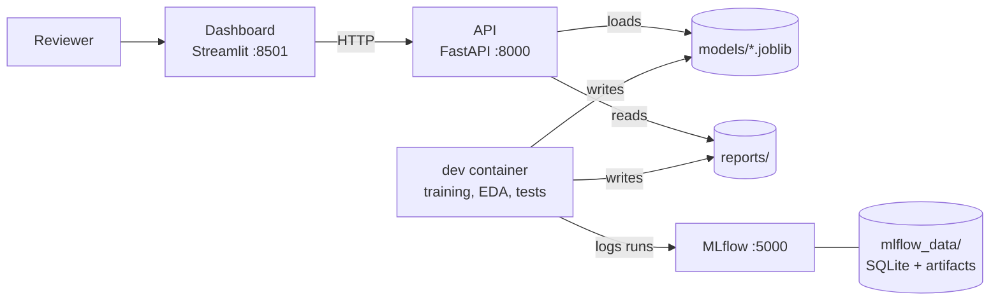

# XAI-based Alternative Credit Scoring System

> ⚠️ **This system was developed for educational purposes and must not be used for real financial decisions.**
> The alternative-data variables and gender are simulated, not real.

[한국어](README.md)

## Overview

For thin-filers (people with little credit history), we build a credit scoring model that adds **alternative data** such as telecom and utility payments, and check the **explainability (SHAP)** and **fairness (DI ratio, equalized odds)** that the Financial Services Commission AI guidelines require.
Team 4무원, Capstone Design II / Industry Project (CSE4187), Sogang University.

- **Data**: Kaggle Give Me Some Credit (GMSC) + alternative-data simulator (Gaussian copula, 5 mission variables + 3 extras); German Credit as a secondary dataset
- **Models**: Logistic Regression / XGBoost / LightGBM × feature group (traditional / alternative / combined) × imbalance handling (none / class_weight / SMOTE), 5 × 5-fold stratified CV, monotonic constraints
- **Scoring**: probability of default (PD) → credit score (0 to 1000) → risk grade (A to E) → approval (score ≥ 475)
- **XAI**: global and local SHAP, top 5 rejection reasons in plain language, per-variable actionability (for DiCE recourse)
- **Fairness**: DI ratio and equalized odds by gender and age band, bias mitigation
- **Statistics**: two one-way ANOVAs + Tukey HSD
- **Serving**: FastAPI (inference API) + Streamlit (reviewer dashboard) + MLflow (experiment tracking)

## Architecture



The dashboard never loads model files; every prediction and metric goes through the API (MSA).
The dashboard image does not even install the ML libraries.

## Team roles

| Name | Role | Responsibilities |
| --- | --- | --- |
| 김원빈 | Data, modeling | Data loading and cleaning, alternative-data simulator, thin-filer rule, per-variable actionability, model comparison and monotonic training, PD to score mapping |
| 체민규 | XAI, fairness, statistics | SHAP and rejection reasons, DiCE recourse and cost function, fairness checks and bias mitigation, ANOVA |
| 윤제진 | MLOps, serving | Docker environment, MLflow server and Model Registry, FastAPI, Streamlit dashboard |
| TBD | | |

## How to run

### Prerequisites

- [Docker Desktop](https://www.docker.com/products/docker-desktop/) (includes Docker Compose v2.22 or later)
- Data: follow [data/README.md](data/README.md) to put `data/raw/cs-training.csv` (required) and `data/raw/german.data` (secondary model) in place.
  The trained model `models/xgboost_v1.0.joblib` and the `reports/` folder are committed, so the services start without the data.

### 1. Start all services

```bash
git clone <repo URL>
cd <repo folder>
cp .env.example .env        # optional: defaults are used without it
docker compose up --build   # same as docker-compose up
```

| Service | Address |
| --- | --- |
| API (Swagger UI) | http://localhost:8000/docs |
| Dashboard | http://localhost:8501 |
| MLflow UI | http://localhost:5000 |

Stop: `docker compose down`

### 2. Data pipeline and training (dev container)

Run in order (fully seeded). The dev container has `MLFLOW_TRACKING_URI=http://mlflow:5000`, so every run shows up in the MLflow UI (experiments `nextstep-lr`, `nextstep-lgbm`, `nextstep-xgb`, `nextstep-final`, `nextstep-audit`).

```bash
# Cleaning: data/raw/cs-training.csv → data/processed/gmsc_clean.csv (prints column names, dtypes, missing ratios)
docker compose --profile dev run --rm dev python -m src.data

# Alternative-data simulator: → data/processed/gmsc_sim.csv
docker compose --profile dev run --rm dev python -m src.data.simulator

# Model comparison → monotonic constraints → final model (about 15 minutes): models/xgboost_v1.0.joblib, reports/*.csv, final_summary.json
docker compose --profile dev run --rm dev python -m src.models.train --stage all
```

Optional: reports, figures and checks, the actionability Excel, the German Credit secondary model (about 20 seconds)

```bash
docker compose --profile dev run --rm dev python notebooks/eda.py
docker compose --profile dev run --rm dev python notebooks/simulator_report.py
docker compose --profile dev run --rm dev python notebooks/simulator_scenarios.py
docker compose --profile dev run --rm dev python notebooks/model_report.py
docker compose --profile dev run --rm dev python notebooks/audit.py
docker compose --profile dev run --rm dev python -m src.data.actionability_table
docker compose --profile dev run --rm dev python -m src.models.german
```

### 3. Development environment (dev container)

A container with Python 3.12 and every library, with the whole repo mounted at `/app`.
Files created inside it (notebooks, models, reports) stay on the host.

```bash
# JupyterLab → http://localhost:8888 (token: JUPYTER_TOKEN in .env, default xai-dev)
docker compose --profile dev up -d dev

# Tests
docker compose --profile dev run --rm dev pytest

# Shell in the container
docker compose --profile dev run --rm dev bash
```

To see API and dashboard changes live, run `docker compose watch` (changes in `src/` are applied automatically).

> **Import rule**: import every module from `src.`, as in `from src.data.loader import ...`, and run scripts as
> `python -m src.models.train`. (`src/statistics` has the same name as the standard library `statistics`, so putting
> `src/` itself on sys.path causes a clash.)

### Running locally without Docker

Requires Python 3.12 or later (xgboost 3.4 and the library versions of the trained model).

```bash
bash setup.sh                 # Windows: setup.bat
source .venv/bin/activate     # Windows: .venv\Scripts\activate
python -m src.data
python -m src.data.simulator
python -m src.models.train --stage all
```

If `MLFLOW_TRACKING_URI` is not set in the shell, runs go to the local SQLite store `mlruns/`.
View it with `mlflow ui --backend-store-uri sqlite:///mlruns/mlflow.db`.
Do not copy a local `mlruns/` into a container (it stores absolute artifact paths); rerun training in Docker instead.

> **Windows note:** the shipped model was trained on macOS, and the Windows build of XGBoost cannot read the
> format of the random-number state (`rng_state`) stored in it (`XGBoostError: input stream corrupted`). The Linux
> containers (api, dev) load it fine. On Windows, train and test in the dev container, and never commit a model
> trained natively on Windows.

### Tests

```bash
pytest
```

Some tests need files that are not committed (`data/processed/*.csv`, `mlruns/`). Create them with the pipeline commands above.

- **Default:** if those files are missing, the tests that need them are **skipped** with a message saying which command to run.
- **`REQUIRE_DATA=1`:** missing files make those tests **fail** instead. Set it in CI and for the final check.
  The dev container receives `REQUIRE_DATA` from `.env`.
- The MLflow tracking checks (`tests/test_versioning_mlflow.py`) read the local store `mlruns/`.
  If runs were logged only to the MLflow server, these tests are skipped (they fail with `REQUIRE_DATA=1`).
- Run natively on Windows, the 3 tests that load the shipped model fail because of the Windows note above. Use the dev container.

## Model results (official: test set, shipped model `models/xgboost_v1.0.joblib`)

XGBoost, 21 features, no resampling, 13 monotonic constraints; trained on train + validation, evaluated once on the 15% test set. 95% bootstrap intervals.

| Mission target | Test result |
| --- | --- |
| AUC ≥ 0.78 | 0.949 (0.944 to 0.953) |
| KS ≥ 0.28 | 0.760 (0.745 to 0.776) |
| Thin-filer AUC gain ≥ +0.03 | +0.071 (+0.052 to +0.092) |
| PSI < 0.1 | 0.0004 |
| AUC loss from monotonic constraints ≤ 0.01 | 0.0000 (validation) |

**These numbers are optimistic.** The simulator uses the real outcome for every row, including the test set (as in the mission's example), and each mission variable alone reaches AUC 0.80 to 0.84. The realistic reference is the GMSC-only model (CV AUC 0.864; thin-filer test AUC 0.861). See [reports/model_report_en.md](reports/model_report_en.md).

## Environment variables

Copy `.env.example` to `.env`. Model and business settings live in `configs/*.yaml` (see Configuration below).

| Variable | Default | Description |
| --- | --- | --- |
| `API_PORT` / `DASHBOARD_PORT` / `MLFLOW_PORT` / `JUPYTER_PORT` | 8000 / 8501 / 5000 / 8888 | Host ports |
| `API_URL` | `http://localhost:8000` | API address the dashboard calls (`http://api:8000` inside containers) |
| `MLFLOW_TRACKING_URI` | `http://localhost:5000` | MLflow server address (`http://mlflow:5000` inside containers). The training script reads the shell variable; unset or a folder path means the local `mlruns/` |
| `MODEL_NAME` / `MODEL_VERSION` | `xgboost` / `v1.0` | Model the API loads → `models/xgboost_v1.0.joblib` |
| `MODEL_DIR` / `DATA_DIR` / `REPORTS_DIR` | `models` / `data` / `reports` | Paths relative to the project root |
| `CONFIG_PATH` | `configs/config.yaml` | Shared settings (mission thresholds, XAI, fairness, statistics) |
| `LOG_LEVEL` | `INFO` | Log level |
| `PYTHON_VERSION` | `3.12` | Python version of the Docker images |
| `REQUIRE_DATA` | `0` | `1` makes tests that need data fail instead of skip |
| `KAGGLE_USERNAME` / `KAGGLE_KEY` | - | Kaggle data download ([data/README.md](data/README.md)) |
| `JUPYTER_TOKEN` | `xai-dev` | JupyterLab token |

## Configuration (all settings live here, not in code)

| File | Controls |
| --- | --- |
| `configs/config.yaml` | Mission performance targets, disclaimer, XAI (top 15, 5 rejection reasons), fairness (protected attributes, DI 0.8 to 1.25, EO 0.10), statistics (alpha, eta squared bands) |
| `configs/data.yaml` | Cleaning rules (special codes, utilization threshold, minimum age) |
| `configs/simulator.yaml` | The 8 alternative variables (distributions, observed / latent correlation targets, shared factor), credit link, `thin_filer_ratio` / `thin_filer_mode` / `bias_ratio`, thin-filer rules, age bands |
| `configs/actionability.yaml` | Per-variable actionability class, direction, step, bounds, monotone sign, `dice_vary`, `model_feature`, notes (Korean and English) |
| `configs/train.yaml` | Split (70/15/15), CV (5 × 5-fold), model grid, hyperparameters, winner rule, model version, MLflow experiments |
| `configs/scoring.yaml` | PD to score (0 to 1000), grades A to E, approval rule (score ≥ 475), recourse target (495) |
| `configs/german.yaml` | German Credit secondary model |

## Directory layout

```
.
├── configs/                 # Settings YAML (table above)
├── data/                    # raw/ and processed/ (not committed, see data/README.md)
├── docs/                    # Experiment report (experiment_report.pdf)
├── mlflow_data/             # MLflow server database and artifacts (docker volume, not committed)
├── models/                  # Trained models ({algorithm}_v{version}.joblib, e.g. xgboost_v1.0.joblib)
├── notebooks/               # EDA, simulator, model and audit report scripts (nothing in src/ depends on them)
├── reports/                 # Reports (Korean and English), figures/, result tables, actionability Excel, team handoff files
├── src/
│   ├── config.py            # Environment variables (.env) + configs/config.yaml loader
│   ├── utils/               # Shared utilities such as the logger
│   ├── data/                # loader, preprocessor, simulator, features (thin-filer rule), actionability_table
│   ├── models/              # train, evaluate, scoring, german (+ registry planned)
│   ├── explainer/           # SHAP explanations, rejection reasons
│   ├── fairness/            # DI ratio, equalized odds, bias mitigation
│   ├── statistics/          # anova.py (one-way ANOVA, Tukey HSD)
│   ├── api/                 # FastAPI (main.py, schemas.py)
│   └── dashboard/           # Streamlit (app.py, api_client.py)
├── tests/                   # pytest suite
├── Dockerfile               # Multi-stage: mlflow / api / dashboard / dev
├── docker-compose.yml       # API + Dashboard + MLflow (+ dev profile)
├── requirements.txt         # Runtime dependencies (pinned)
├── requirements-dev.txt     # Dev tools (pytest, jupyterlab, ruff)
├── requirements-dashboard.txt  # Dashboard image only (no ML libraries)
├── pyproject.toml           # pytest and ruff settings
├── setup.sh / setup.bat     # Local virtual environment without Docker
└── .env.example             # Environment variable template
```

`mlruns/` (local MLflow store) is not committed; `python -m src.models.train` rebuilds it.

## Reports

| Topic | Report |
| --- | --- |
| Data cleaning and thin-filer definition | [reports/data_report_en.md](reports/data_report_en.md) |
| EDA | [reports/eda_report_en.md](reports/eda_report_en.md) |
| Alternative-data simulator | [reports/simulator_report_en.md](reports/simulator_report_en.md) |
| Model comparison, test results, SHAP, scoring | [reports/model_report_en.md](reports/model_report_en.md) |
| Audit (recourse, fairness, stability, sensitivity) | [reports/audit_report_en.md](reports/audit_report_en.md) |
| MLflow guide | [reports/mlflow_schema_en.md](reports/mlflow_schema_en.md) |
| ANOVA handoff | [reports/anova_handoff_en.md](reports/anova_handoff_en.md) |
| German Credit secondary model | [reports/german_report_en.md](reports/german_report_en.md) |
| Actionability table | `reports/actionability_table_en.xlsx` (generated from the YAML; never edit by hand) |

Every report also has a Korean version (`_ko`). The final experiment report (PDF) goes in `docs/experiment_report.pdf`.

## Team handoff (open work)

**Everyone:** `data/processed/split.csv` (row_id, split) defines train / validation / test. Tune thresholds and fairness mitigation on **validation**; report them on **test**.

**체민규 (fairness, SHAP, DiCE, cost function, ANOVA)**
- `configs/actionability.yaml` and the Excel files: which variables DiCE may vary (`dice_vary`), direction, step, bounds, difficulty, months per step. `spending_consistency`'s step, difficulty and duration are team assumptions that need mentor review.
- Recourse target: score 495 (`recourse_target_score`); approval stays at 475. Paths aimed at 495 stay approved 90.8% of the time under retraining.
- **Rejection reasons:** the NOT_RECOMMENDED variables (`regular_payment_count`, `app_login_frequency`, which are SHAP #1 and #2, plus open credit lines and real estate loans) appear only under "reference (not changeable)", never as advice. TIME_ONLY paths are phrased as waiting time.
- **Open fairness item:** the age-band equalized-odds gap is 0.121, which fails the 0.10 target (DI 0.832 passes; gender passes).
- **Open recourse item:** path coverage at the 495 target is 87.9% over 12 months (91.8% over 24 months), below the 90% goal (see the audit report).
- DiCE should link income and debt ratio (raising income lowers the ratio).
- ANOVA data: `reports/cv_fold_auc.csv` (5 × 5 folds, segments all / thin / general) and [reports/anova_handoff_en.md](reports/anova_handoff_en.md).
- Real-gender check: `reports/german/oof_predictions.csv` (see [reports/german_report_en.md](reports/german_report_en.md)).

**윤제진 (MLflow, Docker, FastAPI, Streamlit)**
- [reports/mlflow_schema_en.md](reports/mlflow_schema_en.md): experiments (one per algorithm, plus final and audit), metric keys, the 21 input columns, how to load the model. Every model artifact has a signature and input example; the served model returns probabilities (column 1 = PD).
- The training code uses the MLflow 3 API. Model stages are deprecated in MLflow 3, so mark the registered model with an alias (e.g. `production`, `staging`) or a tag.
- To get the runs into the MLflow server, rerun training in the dev container (How to run, step 2).
- The API loads `models/xgboost_v1.0.joblib` from `MODEL_NAME` / `MODEL_VERSION` (version in `configs/train.yaml`; also in `reports/final_summary.json` for `/health`). Use `src/models/scoring.py` for PD to score, grade and approval.

## Limitations

- **Simulation bias:** the simulator uses the target for all rows, test included, as in the mission's example. The GMSC-only results are the realistic reference.
- **Correlation rule:** the 5 mission variables are calibrated to observed r = −0.32 (the checklist verifies `df.corr()`), which makes each of them stronger than any real credit feature. At r = −0.50 the 0.60 cap between variables cannot be met.
- **Fairness:** the age-band EO gap (0.121) fails the 0.10 target; decisions near the cutoff flip in 26.8% of cases when retrained.
- **PSI** compares random samples of the same population, so it is close to 0 by construction; GMSC has no dates for a drift test.
- **The mission's thin-filer rule** (2+ missing past-due columns or card history < 12 months) flags 0% of raw GMSC, so a proxy is used (`is_thin_filer_mission` is implemented; see the data report).
- Grade cutoffs, approval rule and recourse costs are team assumptions, not values from a lender.
- German Credit is a separate small model (1,000 rows, no single women); its numbers are not comparable with GMSC.

## Collaboration rules

- **Branches**: keep `main` runnable at all times; work on `feat/<topic>`, `fix/<topic>`, `docs/<topic>` branches.
- **Issue → PR**: open an issue per task (`.github/ISSUE_TEMPLATE`) and link it with `closes #<issue>` in the PR body.
- **Commit messages**: use the prefixes `feat:`, `fix:`, `docs:`, `test:`, `refactor:`, `chore:`, `build:`.
- **Settings**: ports, paths and thresholds go in `.env` or `configs/*.yaml`, never hard-coded.
- **Documents**: the README and `reports/*.md` exist in Korean and English and carry the disclaimer (`tests/test_docs.py` checks this).

## Progress

See the checklist in the [Korean README](README.md#진행-현황).

## Data credit

German Credit: Hofmann, H. (1994). Statlog (German Credit Data) [Dataset]. UCI Machine Learning Repository. https://doi.org/10.24432/C5NC77 (CC BY 4.0). GMSC: Kaggle "Give Me Some Credit".
